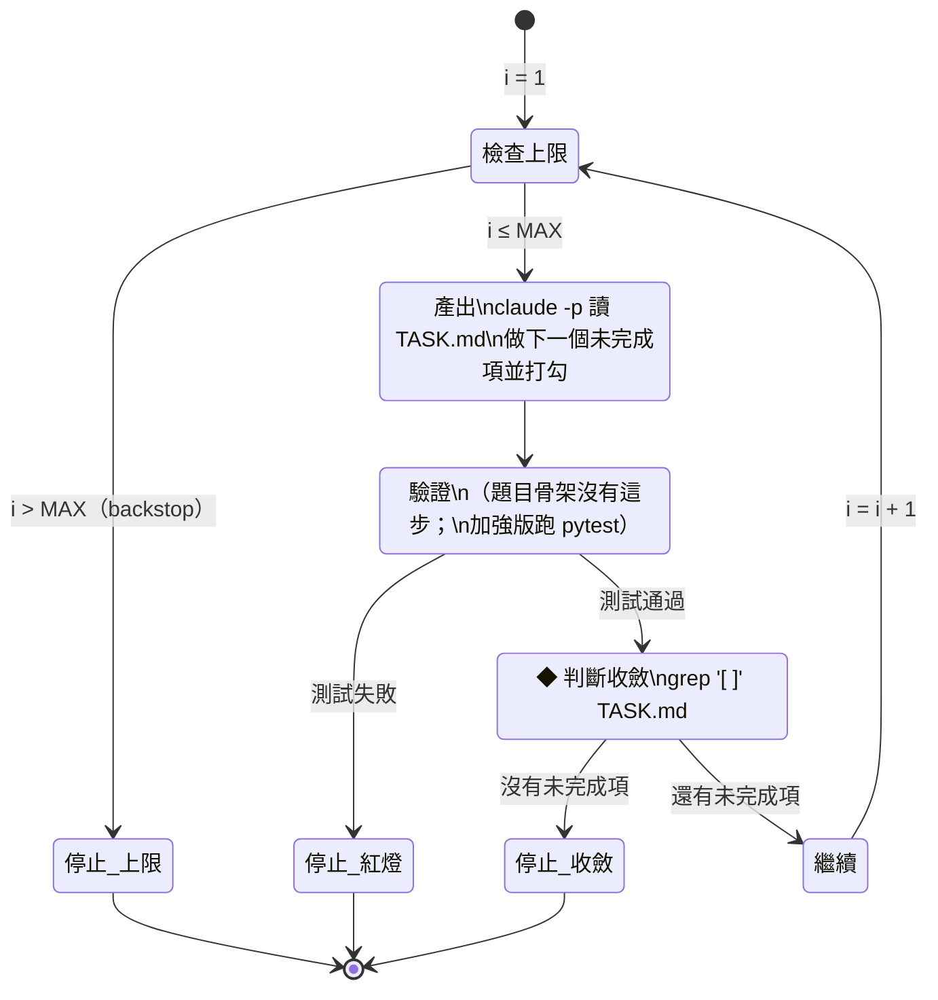

# 練習 01 解答：看懂 Ralph 自主迴圈

> 實作對照：`ralph-demo/ralph.sh`（題目骨架加上護欄後的實際版本，已真的跑過，見 `ralph-demo/logs/`）。

## 任務 1：迴圈的狀態流



純文字版：

```
          ┌──────────────────────────────────────────────┐
          ▼                                              │
  [i ≤ MAX?] ──否──▶ 停止（backstop：上限到了）           │
      │是                                                │
      ▼                                                  │
  ① 產出：claude -p 做下一個未完成項並打勾                  │
      │                                                  │
      ▼                                                  │
  ② 驗證：題目骨架「沒有」；加強版跑 pytest ──紅燈──▶ 停止  │
      │綠燈                                              │
      ▼                                                  │
  ③ ◆收斂判斷點：TASK.md 還有 "[ ]" 嗎？                   │
      ├─沒有──▶ 停止（收斂：全部完成於第 i 輪）             │
      └─還有──▶ ④ 繼續：i+1 ───────────────────────────────┘
```

收斂判斷點就是 `if ! grep -q '\[ \]' TASK.md`：每輪產出之後才判斷，判斷依據是「檔案狀態」而不是 Claude 自己說的話。

## 任務 2：終止條件與逃生條件

### 題目骨架原本就有的（2 個）

| 類型 | 條件 | 程式碼 | 性質 |
| --- | --- | --- | --- |
| 收斂（正常結束） | TASK.md 已沒有 `[ ]` | `grep -q '\[ \]' TASK.md` 為假 → `break` | 成功出口 |
| backstop 上限 | 跑滿 MAX=10 輪 | `for i in $(seq 1 "$MAX")` 自然結束 | 失敗保險：防失控 |
| （附帶）set -e | `claude -p` 回傳非 0 | `set -euo pipefail` 讓腳本直接中止 | 意外的逃生：Claude 出錯就整個停 |

### 骨架的缺陷（看懂後發現的）

1. **沒有驗證步驟**：Claude 打勾就算完成，寫錯也會被當成進度。
2. **上限到了沒有告知**：跑滿 10 輪會安靜結束，看不出是「完成」還是「放棄」（結束碼都是 0）。
3. **沒有防空轉**：Claude 每輪什麼都不做也會跑滿 10 輪，白燒額度。
4. **沒有逃生的時間上限**：單次 `claude -p` 卡住就永遠卡住。

### 加強版的「立刻停」逃生條件（ralph.sh 實作）

| 逃生條件 | 觸發時機 | 結束碼 |
| --- | --- | --- |
| 收斂 | 未完成項 = 0 | 0 |
| pytest 紅燈 | 任一輪測試失敗（不 commit，保留現場） | 2 |
| 連續 2 輪無進展 | 未完成項數量沒下降 | 3 |
| 達上限 MAX=6 | 跑滿仍未收斂 | 4 |
| 單輪逾時 | `timeout 300 claude -p …` | 交給上面的護欄判斷 |
| 整體逾時 | 外層 `timeout 1800 bash ralph.sh …` | 124 |

## 驗收標準

- [x] 狀態流清楚標出收斂判斷點（③ `grep '\[ \]' TASK.md`）
- [x] 至少 2 個停止條件（收斂 + backstop 上限，加強版再多紅燈、無進展、逾時）
