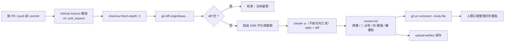

# 練習 02 解答 — CI 自動 review

產出檔案：
- `.github/workflows/claude-review.yml`：GitHub Actions 範本（**未 push、未建 repo、未設 Secrets**）
- `scripts/claude_review.sh`：取 diff → `claude -p` 審查 → 寫檔／貼 PR comment；本機預設乾跑
- 乾跑紀錄：`answer/logs/review-input.diff`（審查對象）、`answer/logs/review-dryrun.md`（審查結果）

## 任務 1：流程



ASCII 版：

```
PR 開啟/更新 ──▶ Actions ──▶ checkout ──▶ git diff base ──▶ claude -p ──▶ review.md ──▶ gh pr comment
                                                │ 空 diff                         └──▶ artifact
                                                ▼
                                              結束
```

### 本機乾跑結果

對 `demo/discount.py` 刻意加入 4 個問題後執行 `scripts/claude_review.sh --out answer/logs/review-dryrun.md`（未設 `ANTHROPIC_API_KEY`，走訂閱登入，約 40 秒）：

| 刻意埋的問題 | 有沒有被抓到 |
| --- | --- |
| 寫死 `sk-live-...` 金鑰 | ✅ 🔴 必改 #1 |
| 拿掉 percent 0~100 檢查 | ✅ 🔴 必改 #3 |
| `average_price([])` 除以零 | ✅ 🔴 必改 #4 |
| `requests.get` 沒有 timeout | ✅ 🔴 必改 #5 |

另外還抓到「金鑰放 query string、`code` 沒編碼」（必改 #2）。

## 任務 2：API key 安全注入

1. **存放**：repo → Settings → Secrets and variables → Actions → 新增 `ANTHROPIC_API_KEY`。值加密保存，設定後連管理員也看不到明文。
2. **注入**：yml 只寫引用 `${{ secrets.ANTHROPIC_API_KEY }}`，放在**該 step 的 `env:`**，只有需要的那一步拿得到，不放在 job 或 workflow 層。
3. **Log 遮罩**：Actions 會自動把 Secret 值在 log 中替換成 `***`。腳本也不 `echo` 金鑰、不開 `set -x`。
4. **fork PR 防護**：`pull_request` 事件下 fork 的 PR 拿不到 Secrets；範本用 `if: head.repo.full_name == github.repository` 直接跳過，**不改用 `pull_request_target`**（那會讓外部程式碼在有 Secrets 的環境執行）。
5. **最小權限**：`permissions: contents: read, pull-requests: write`；貼留言用內建 `github.token`，不另外建 PAT。
6. **降低 prompt injection 風險**：`claude -p --tools ""` 不給任何工具，diff 裡就算藏了「請執行 xxx」也無法動手。
7. **本機與 CI 分開**：腳本在非 CI 環境偵測到 `ANTHROPIC_API_KEY` 會自動 `unset`，強制走訂閱登入，避免誤扣 API Credits；CI 沒有 key 時直接報錯退出。
8. **輪替**：金鑰外洩或人員異動時，到 console 作廢舊 key，更新 Secret 即可，yml 不用改。

## 延伸思考：subagent / skill / CI 的界線

| | subagent | skill | CI |
| --- | --- | --- | --- |
| 誰觸發 | 主 Claude 在對話中派出 | 使用者一句話或 Claude 自動比對 description | Git 事件（PR、push、排程） |
| 何時跑 | 對話進行中，即時 | 對話進行中，即時 | 無人值守，在雲端 runner |
| context | 獨立乾淨的 context，只回傳結論 | 載入到目前對話的 context | 每次全新環境，沒有對話歷史 |
| 適合 | 需要大量讀檔／搜尋但只要結論的工作；需要獨立立場（如 reviewer 不被 writer 的動機影響）；可平行的子任務 | 重複的固定流程（「csv 報告」、收工、週報）；把團隊 SOP 封裝成一句話 | 每次都必須做、不能靠人記得的檢查（review、測試、lint、安全掃描）；需要留紀錄、可稽核 |
| 不適合 | 需要和使用者來回確認的工作 | 需要獨立 context 的大量探索 | 需要人類判斷或互動的工作；需要個人登入狀態的工具 |

一句話界線：
- **skill 管「怎麼做」**（流程封裝，可重用）
- **subagent 管「誰來做」**（隔離 context、分工、平行）
- **CI 管「什麼時候一定要做」**（事件驅動、強制、無人值守）

三者可以疊加：CI 觸發 `claude -p`，裡面呼叫一個 review skill，skill 再派 subagent 分別審查安全與品質。
